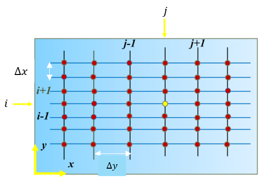
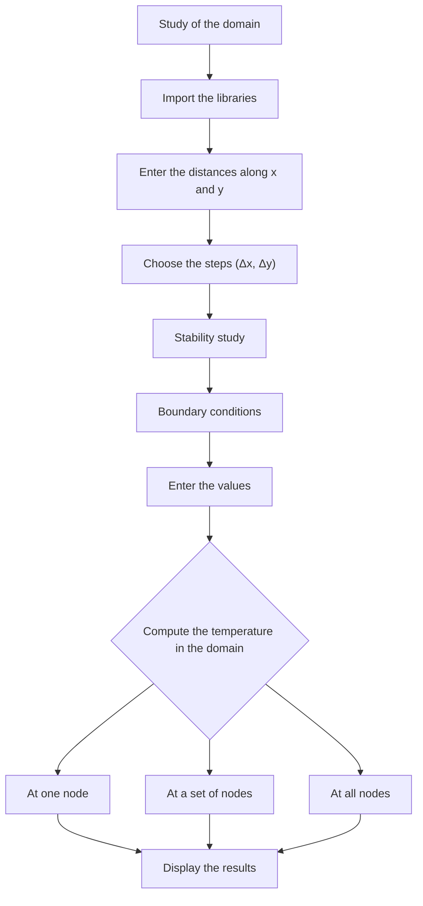
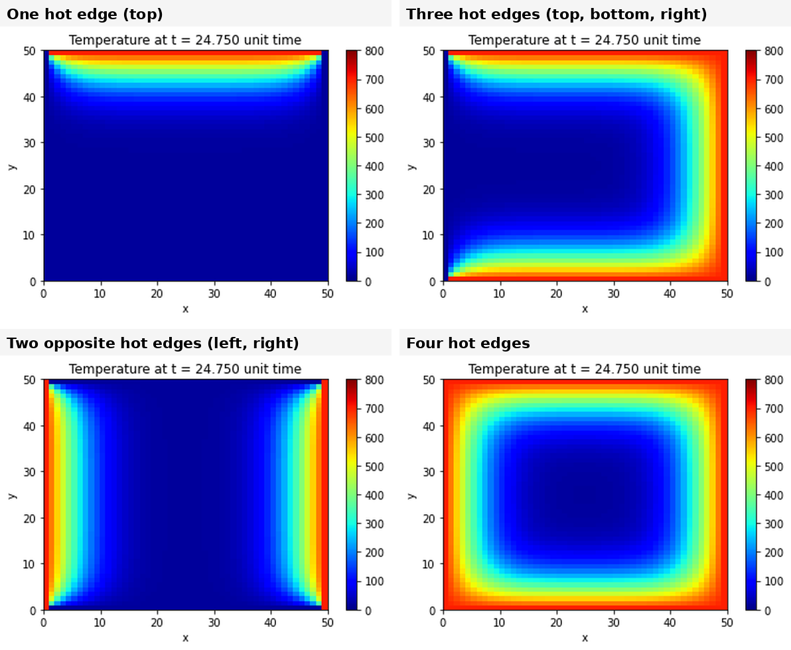
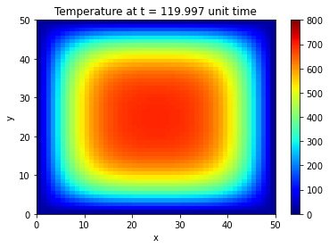
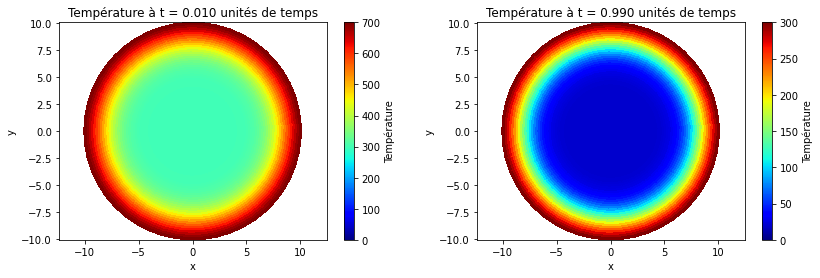

# 2D Heat Equation — Finite-Difference Solver in Python (Plate and Cylinder)

Numerical solution of the unsteady 2D heat equation with an explicit finite-difference scheme in Python: a square plate with fixed edge temperatures (aluminium, copper, lead, concrete), then a cylinder in polar coordinates.

**Author:** Yanis Boutabia — *IPSA Paris, heat-transfer lab "Résolution de l'équation de chaleur en 2D sur Python" (report in French), December 2024.*

## Problem

A thin square plate of side L is initially at a uniform temperature of 20 °C. Its four edges are in perfect thermal contact with imposed temperatures. The temperature T(x, y, t) obeys the heat equation

```
∂²T/∂x² + ∂²T/∂y² = (1/α) · ∂T/∂t        with  α = λ / (ρ·c)
```

where α is the thermal diffusivity (m²/s), λ the thermal conductivity, ρ the density and c the specific heat capacity.

| Material | α (m²/s) | Cell size Δx for γ = 0.25 at Δt = 1 s |
|---|---|---|
| Aluminium | 98.8×10⁻⁶ | 19.88 mm |
| Copper | 117×10⁻⁶ | 21.63 mm |
| Lead | 24×10⁻⁶ | 9.80 mm |
| Concrete | 0.54×10⁻⁶ | 1.47 mm |

## Method

The heat equation is discretized with a first-order explicit (forward Euler) scheme in time and second-order centred differences in space, on a uniform grid (Δx = Δy):

```
T^{n+1}(i,j) = T^n(i,j) + α·Δt · [ (T(i+1,j) + T(i−1,j) − 2·T(i,j)) / Δx²
                                  + (T(i,j+1) + T(i,j−1) − 2·T(i,j)) / Δy² ]
```


*Discretization of the plate: nodes (i, j) with spacings Δx and Δy*

**Stability.** The explicit scheme is stable if γ = α·Δt/Δx² ≤ 1/4 on a uniform grid. In the provided solver, Δt = Δx²/(4α), so γ = 0.25 by construction. For the materials, Δx is chosen so that γ = 0.25 with Δt = 1 s (hence the very different cell sizes in the table above: a low-diffusivity material needs a finer mesh). This sits exactly at the stability limit.

**Boundary conditions.** Dirichlet conditions (imposed temperatures on the edges) were chosen because the edge temperatures are fixed in this study. Neumann conditions (imposed flux φ = −λ·∂T/∂n) were also discussed.

**Algorithm:**



## Plate simulations

The figures show the temperature field over a plate of 50 × 50 grid nodes. The title of each plot gives the elapsed time k·Δt in "unit time" (for the dimensionless runs of the solver in `code/`, 99 steps of Δt = 0.25 give t = 24.75). Four edge configurations were simulated, shown below at the same instant.


*Temperature field with different sets of hot edges (700 °C) on a plate initially at 20 °C, same instant (t = 24.75 time units)*

The reverse case was also run, a plate initially hot and cooled by its four edges at 20 °C.


*Plate initially at 700 °C with its four edges at 20 °C (t ≈ 120 time units)*

## Comparing the materials

Because Δx is adjusted for each material to keep γ = 0.25 at Δt = 1 s, the temperature fields are identical in grid units for the four materials. The material only enters through the cell size Δx and the time step, so the plots alone do not show which material is faster.

The physical difference appears for a plate of a given size. The diffusion time scales as L²/α:

| Material | L²/α for a 0.5 m plate (order of magnitude) |
|---|---|
| Copper | about 2.1×10³ s (≈ 36 min) |
| Aluminium | about 2.5×10³ s (≈ 42 min) |
| Lead | about 1.0×10⁴ s (≈ 2.9 h) |
| Concrete | about 4.6×10⁵ s (≈ 5 days) |

Copper diffuses heat the fastest and concrete the slowest, about 200 times slower than copper, in the ratio of their diffusivities (117 / 0.54 ≈ 217). These are derived estimates of the time scale, not outputs of the simulations.

## Cylinder (polar coordinates)

The same explicit scheme is applied to a disc of radius R = 10 cm (aluminium), discretized in the radial and angular directions. A Dirichlet condition (fixed temperature) is imposed at the rim r = R, and symmetry (∂T/∂r = 0) is used at the centre. Several combinations of initial and boundary temperatures were tried, for example 700 °C initially with a 20 °C boundary, or 200 °C initially with a 0 °C boundary. As the report notes, in all cases heat flows from the hotter to the colder region and the disc tends toward a uniform temperature.


*Temperature field in the disc at t = 0.01 (left) and t = 0.99 (right) time units: heat diffuses between the rim and the centre*

## Limitations and possible extensions

- The scheme runs exactly at its stability limit (γ = 0.25). A slightly smaller Δt would give a safety margin.
- The results were not compared with an analytical solution (for instance a Fourier-series solution for the plate with constant-temperature edges) or with measurements. The polar-coordinate scheme in particular should be checked against an analytical case, such as steady-state or Bessel-function solutions of the disc.
- The plate figures are in solver time units, so the material comparison needs the physical scaling given above.
- Implicit schemes (Crank–Nicolson, implicit Euler) would remove the stability constraint and allow larger time steps, which matters for low-diffusivity materials such as concrete.

## Code

```
Heat-Equation-2D-Python/
├── README.md
├── code/
│   └── heat_equation_2d_plate.py   # Cartesian plate solver (dimensionless form)
└── images/
```

`code/heat_equation_2d_plate.py` is the plate solver in dimensionless form (α = 1, Δx = 1, Δt = Δx²/(4α), so γ = 0.25) on a 50 × 50 grid for 100 time steps. It is set up with one example of imposed temperatures (initial 400 °C; top 800, left 250, bottom 40 and right 800 °C), saves an HTML animation and plots snapshots at k = 1, 10 and 99. The material runs of the report use the physical α and Δx of the table above, and the cylinder (polar coordinates) version is not included.

**How to run:** `python heat_equation_2d_plate.py` (NumPy and Matplotlib). If saving the HTML animation fails with the default FFmpeg writer, use `anim.save("fdm_2d_heat_equation_solution.html", writer="html")`.

## Tools

`Python` (NumPy, Matplotlib) — explicit finite-difference solver, heat-map visualization and animation

---
*Academic lab report — IPSA Paris, December 2024.*
